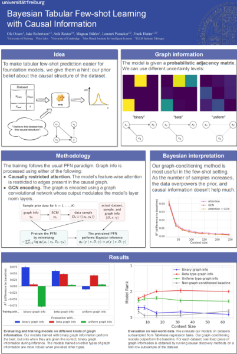
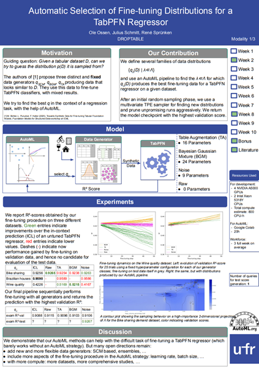

# Posters of some projects I did (click to enlarge)

## Small Footprint Motion Prediction with Teacher-Student Learning (with Vladislav Pikulin, Kenta Baron-Furuyama)

We implemented different distillation methods for making a faster motion detection network. My method is in red.

## Bayesian Tabular Few-shot Learning with Causal Information

For my Master project, I developed a method for incorporating graphical information into tabular models.

## Causal feature selection using AVICI (with Hani Alnahas)

We used a causal foundation model for feature selection.

## Automatic Selection of Fine-tuning Distributions for a TabPFN Regressor (with Julius Schmitt, René Sprünken)

For the AutoML lecture's exam, we looked into automatic data generation for fine tuning prior-fitted networks.

